## Про мене {.no-line}

:::: {.columns}

::: {.column width="62%"}
[Анна Мірошниченко]{.hook}

**PhD з філософії**, КНУ імені Тараса Шевченка (2014).
Дисертація на тему феноменології релігії.

Була головною редакторкою наукового журналу «Історія, філософія, релігієзнавство».

Поза філософією:

::: tags
[Історична реконструкція]{} [LARP]{} [Історія костюма]{} [Дизайн одягу]{} [Handmade]{} [Фентезі]{}
:::
:::

::: {.column width="38%" .portrait}
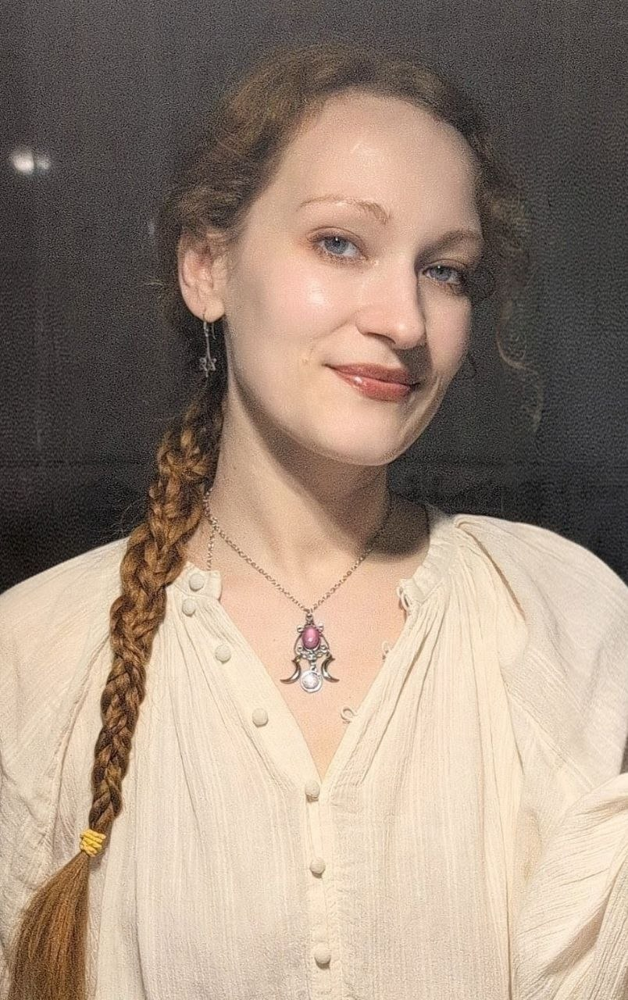{height="560px" fig-align="center"}
:::

::::

::: notes
Коротко про себе, без переліку курсів. Хобі варто назвати вголос: реконструкція і LARP показують, що філософію можна «приміряти» на себе так само, як історичний костюм. До цієї думки можна повернутись наприкінці.
:::

## {.no-line}

[Підніміть руку, хто за останній тиждень...]{.muted .big}

::: {.chat}
::: {.msg .in}
**Керівник**

Ок.
:::
:::

::: {.show}
[...прочитав у коротке «Ок.» прихований невдоволений підтекст?]{.hook}
:::

::: {.show}
[...побудував у голові катастрофічний сценарій, не маючи жодного факту?]{.hook}
:::

::: notes
**Запитання до залу:** Хто з вас сьогодні накрутив себе через непрочитане повідомлення або занадто складне пояснення банальної події?

**Теза:** Ми щодня витрачаємо гігабайти енергії на катастрофізацію, теорії змов на роботі чи в новинах, розчарування в людях і відчуття вигоряння. Філософія не нудні томи схоластики на полицях, а когнітивні драйвери, які визначають, як наш мозок обробляє вхідні дані, новини й конфлікти.

---

Інтерактив із залом. Спершу показати лише «Ок.» і дати секунду на реакцію. Потім по кліку два запитання, після кожного попросити підняти руки.

Перехід: «Так працює наша внутрішня "операційна система". Вона обробляє вхідні дані за правилами, яких ми свідомо не встановлювали».
:::

## Філософія, якою ви вже користуєтесь

:::: {.columns}

::: {.column width="60%"}
Кожен з нас має набір правил за замовчуванням:

- як тлумачити чуже мовчання,
- що вважати своєю провиною,
- коли боротися, а коли відпустити,
- навіщо взагалі все це робити.

::: {.show}
Ці правила і є філософією. Питання лише в тому, чи ви їх **обрали**, чи вони **встановились самі**.
:::

::: {.aside-note}
Французький історик філософії П'єр Адо показав, що в античності філософія була способом життя: щоденними вправами для думки, а не системою текстів для іспиту.
:::
:::

::: {.column width="40%" .portrait}
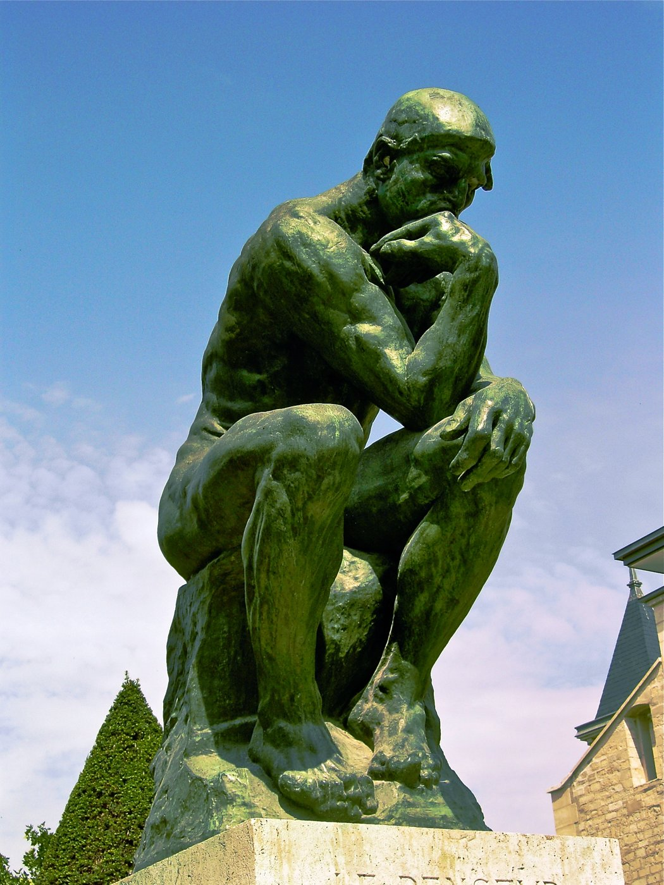{width="80%" fig-align="center"}

::: credit
Огюст Роден, «Мислитель». Wikimedia Commons
:::
:::

::::

::: notes
**Теза:** Філософія не відірвана від життя академічна схоластика, а набір когнітивних «драйверів» і «базових алгоритмів», через які ми інтерпретуємо події, людей і стрес.

---

Головна теза вступу. Ми щодня витрачаємо силу на катастрофізацію, підозри, розчарування в людях. Філософія тут не томи на полиці, а «драйвери», через які мозок обробляє новини, конфлікти й чужі слова.

П'єр Адо, «Philosophy as a Way of Life» (франц. «Exercices spirituels et philosophie antique», 1981).
:::

## Чотири набори інструментів



::: {.pt-3}
Кожен блок відповідає на одне практичне запитання: **як думати ясно**, **як не зламатись**, **навіщо діяти**, **як бути з іншими**.
:::

::: notes
Карта лекції. Вона повертатиметься перед кожним блоком, щоб слухачі бачили, де ми.
:::

# Ясність мислення {.divider .at-1 background-color="#00D0FF"}

[Блок 1]{.kicker}

[Як перевіряти власні думки і не шукати змову там, де звичайний безлад]{.lead}



## Сократ: питання замість повчань {.b1}

:::: {.columns}

::: {.column width="58%"}
Сократ нічого не записував і не читав лекцій. Він ходив афінським ринком і **розпитував**: що таке справедливість, мужність, добро.

Його переконання: істину неможливо передати в готовому вигляді. Вона народжується лише в спільному дослідженні.

::: {.show}
::: {.bigquote}
Життя без дослідження не варте того, щоб його жити.

[Сократ, за Платоном]{.who}
:::
:::
:::

::: {.column width="42%" .portrait}
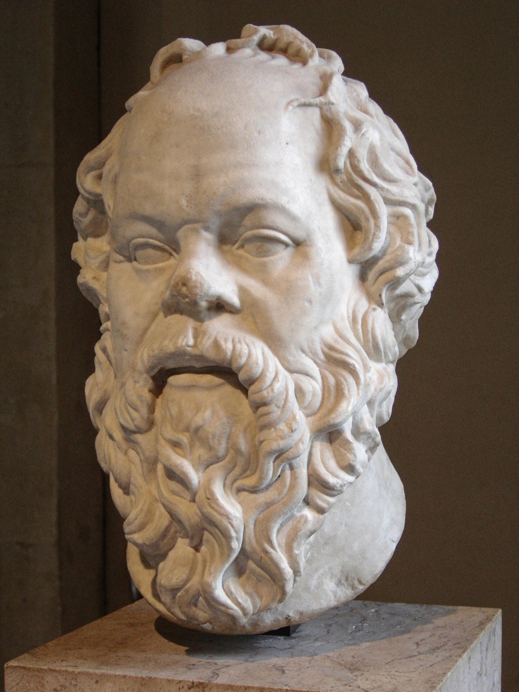{width="78%" fig-align="center"}

::: credit
Бюст Сократа, Лувр. Wikimedia Commons
:::
:::

::::

::: notes
**Сократівський діалог: деконструкція автоматичних реакцій**

- **Суть методу:** істина народжується не в лекції, а в системі цілеспрямованих відкритих запитань.
- Сократ вважав, що істина ніколи не передається в готовому вигляді як директива чи напучування. Вона народжується лише в процесі спільного дослідження та розмірковування.
- **Головна мета:** допомогти людині (чи самому собі) самостійно розпізнати суперечності у власних поглядах, позбутися хибних догм і дістатися глибинної ясності.

---

Мета методу: допомогти людині (чи собі) самостійно побачити суперечності у власних поглядах, позбутися хибних догм і дійти ясності.

Цитата: Платон, «Апологія Сократа», 38a.
:::

## Ціна запитань {.b1 .over-image background-image="img/philosophy/socrates_death.jpg" background-size="cover"}

:::: {.columns}

::: {.column width="55%"}
::: {.panel}
**399 рік до н. е.** Афінський суд засуджує Сократа на смерть: він нібито не шанує богів і «псує молодь».

Насправді він роками ставив незручні запитання впливовим людям, і ті виглядали на людях не надто розумними.

::: {.show}
Друзі підготували втечу. Сократ відмовився й випив цикуту.
:::

::: credit
Жак-Луї Давид, «Смерть Сократа», 1787
:::
:::
:::

::::

::: notes
Цей слайд пояснює, чому метод сприймали так гостро: запитання оголювали, що «знавці» насправді не знають. Платон описує суд в «Апології», а останній день Сократа у «Федоні».
:::

## Метод у чотири кроки {.b1}

[Теза: *«Мене ніхто не цінує на роботі»*]{.muted}

::: {.steps}
::: {.step}
[1. Теза]{.t}

Людина висловлює тверде переконання.

[«Мене ніхто не цінує»]{.ex}
:::

::: {.step}
[2. Еленхос]{.t}

Уточнювальні запитання без критики в лоб.

[«Хто саме ніхто? Що конкретно сталося?»]{.ex}
:::

::: {.step}
[3. Апорія]{.t}

Теза натрапляє на контрприклади й розсипається.

[«Ну, минулого місяця мене хвалили...»]{.ex}
:::

::: {.step}
[4. Маєвтика]{.t}

Народжується зважена думка.

[«Мене не помітили в цьому проєкті. Я можу про нього розповісти»]{.ex}
:::
:::

::: {.aside-note .pt-3}
**Маєвтика** (μαιευτική) означає «повивальне мистецтво». Мати Сократа була повитухою, і він казав, що теж допомагає народжуватись, тільки думкам.
:::

::: notes
**Головна мета:** допомогти людині (чи самому собі) самостійно розпізнати суперечності у власних поглядах, позбутися хибних догм і дістатися глибинної ясності.

**Ключовий прийом — еленхос (ἔλεγχος):** мистецтво послідовного спростування, або перехресного опитування. Через ланцюжок точних запитань наочно оголюється логічна слабкість і непослідовність вихідної тези.

**Чотири класичні етапи методу Сократа**

1. **Формулювання тези.** Співрозмовник озвучує тверде судження чи переконання: «Я точно знаю, що справедливість — це...» або «У мене нічого не вийде в цьому проєкті». Приклад когнітивного спотворення: «Мене ніхто не цінує на роботі».
2. **Сумнів і уточнення (еленхос).** Сократ не критикує в лоб, а щиро цікавиться, ставить уточнювальні запитання, ніби погоджуючись, але намацуючи логічні прогалини: «Що конкретно змусило так думати? Чи були зворотні приклади?»
3. **Аргументація через контрприклади.** Серія запитань підводить людину до ситуацій, де її вихідна теза сама собі суперечить або вимагає абсурдних припущень.
4. **Усвідомлення незнання (апорія) та висновок.** Узагальнення руйнується. Співрозмовник бачить, що його первинна думка була надто поверхневою чи узагальненою, і приходить до нового, дорослого розуміння.

**Маєвтика:** народження зваженої оцінки.

---

**Еленхос** (ἔλεγχος): перехресне опитування. Сократ ніби погоджується, щиро цікавиться і ставить точні запитання, поки не оголиться логічна слабкість тези.

**Апорія**: стан «глухого кута», коли співрозмовник бачить, що його думка була надто узагальненою. Це не поразка, а початок нормальної розмови.

Про повитуху: Платон, «Теетет», 149a–151d.
:::

## Як це звучить зсередини {.b1}

::: {.chat}
::: {.msg .in}
Мене ніхто не цінує на роботі.
:::

::: {.msg .self}
**Хто саме?** Усі сорок людей у компанії?
:::

::: {.msg .in}
Ну... керівник і двоє з команди.
:::

::: {.msg .self}
**Що конкретно** вони зробили чи не зробили?
:::

::: {.msg .in}
На зустрічі не згадали мою частину звіту.
:::

::: {.msg .self}
А **чи були випадки**, коли твою роботу помічали?
:::

::: {.msg .in}
Були. У вересні. І колега вчора дякувала.
:::

::: {.msg .self}
Тож **точніше** буде так: «На цій зустрічі мою частину пропустили». Що з цим можна зробити?
:::
:::

::: notes
Тут показати весь діалог по кліках, повільно. Головне, що людина не сперечається сама з собою і не соромить себе. Тон: як друг, якому щиро цікаво.
:::

## Сократ у сучасній психотерапії {.b1}

[Когнітивно-поведінкова терапія (КПТ) зробила сократівські запитання робочим інструментом для автоматичних думок.]{.muted}

| Пастка мислення | Як звучить | Сократівське запитання |
|---|---|---|
| Катастрофізація | «Я провалю співбесіду, і все пропало» | Який найімовірніший результат, а не найгірший? |
| Читання думок | «Вона точно вважає мене дурнем» | Звідки я це знаю? Що вона сказала насправді? |
| Узагальнення | «У мене ніколи нічого не виходить» | Ніколи? Згадай три винятки. |
| Чорно-біле мислення | «Якщо не ідеально, то провал» | Що лежить між «ідеально» і «провал»? |
| Ярлики | «Я невдаха» | Це опис учинку чи вирок усій людині? |

: {.striped}

::: notes
**Сучасний місток: практичне застосування**

- **У психотерапії (КПТ і логотерапія):** дослідження автоматичних думок, катастрофізації та когнітивних спотворень без навішування ярликів і самобичування.

---

Аарон Бек, засновник когнітивної терапії (1960-ті), прямо спирався на сократівський діалог. Терапевт не переконує клієнта, а ставить запитання, на які клієнт сам знаходить відповідь (guided discovery). Те саме працює в лідерстві й коучингу: замість мікроменеджменту і готових вказівок питання, які ведуть людину до власного висновку.
:::

## Письмовий діалог із собою за 10 хвилин {.b1}

:::: {.columns}

::: {.column width="55%"}
Коли накриває тривога, візьміть аркуш і **напишіть від руки** відповіді:

1. Що саме я зараз думаю? Одним реченням.
2. На яких **фактах** це ґрунтується?
3. Які факти свідчать **проти**?
4. Що я сказав би **близькому другові** в такій самій ситуації?
5. Як звучить точніша версія думки?
:::

::: {.column width="45%"}
::: {.card .b1}
[Чому саме письмово]{.t}

Думка в голові ходить по колу. На папері вона стає текстом, а текст можна перевірити, як чужий аргумент.
:::

::: {.card .b1 .pt-3}
[Запитання 4 найсильніше]{.t}

З другом ми рідко говоримо так жорстко, як із собою. Це швидкий тест на справедливість.
:::
:::

::::

::: notes
Техніка самодопомоги з плану. Можна запропонувати залу подумки відповісти на запитання 4 про якусь свою недавню думку.
:::

## Ментальні бритви {.b1}

[Бритвами у філософії називають правила, якими «зрізають» зайві пояснення.]{.big}

::: {.cards .c2 .pt-3}
::: {.card .b1}
[Бритва Оккама]{.t}

Зрізає **зайві припущення**.

Коли пояснень кілька, починайте з найпростішого.
:::

::: {.card .b1}
[Бритва Генлона]{.t}

Зрізає **підозру в злому умислі**.

Помилка, втома й неуважність трапляються частіше за підступність.
:::
:::

::: notes
«Ментальні бритви — це філософські леза, якими ми зрізаємо малоймовірні, заплутані та параноїдальні пояснення, щоб економити інтелектуальний ресурс і не шукати змови там, де панує звичайний хаос».
:::

## Вільям Оккам {.b1}

:::: {.columns}

::: {.column width="35%" .portrait}
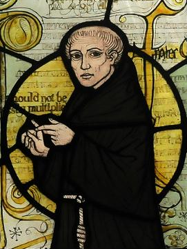{width="88%" fig-align="center"}

::: credit
Вільям Оккам, ескіз за вітражем. Moscarlop, Wikimedia Commons
:::
:::

::: {.column width="65%"}
Англійський чернець-францисканець, бл. 1287–1347. Писав про логіку, богослов'я і фізику Арістотеля. Посварився з Папою і решту життя провів під захистом імператора в Мюнхені.

Вважав, що існування речей засвідчує тільки **безпосередній досвід**. Звідси вимога не вигадувати сутностей, яких ніхто не бачив.

::: {.bigquote}
Pluralitas non est ponenda sine necessitate.

[Не слід примножувати сутності без потреби]{.who}
:::
:::

::::

::: notes
**Персоналія та бекграунд**

- Вільям з Оккама (William of Ockham, бл. 1285–1347): англійський філософ-схоласт, чернець-францисканець.
- Написав низку фундаментальних праць з богослов'я, логіки та фізики Арістотеля.
- **Фундамент теорії пізнання Оккама:** тільки чуттєве, наочне знання (інтуїція досвіду) здатне засвідчити існування реальних фактів. Саме звідси випливає знаменита вимога простоти пояснення.

---

Оккам також показав, що «доведення існування Бога» не є справою раціональної філософії: це питання віри. Для свого часу це був переворот.

Цікавий факт: найвідоміше формулювання «Entia non sunt multiplicanda praeter necessitatem» у текстах самого Оккама не знайдено. Його вигадав пізніший коментатор Джон Панч у XVII ст. Оккамове формулювання саме «Pluralitas non est ponenda sine necessitate».

Якщо явище можна пояснити кількома способами, найімовірніше те пояснення, яке вимагає найменше припущень.
:::

## Чуєте тупіт копит за вікном? {.b1}

:::: {.columns}

::: {.column width="55%"}
::: {.cards .c2}
::: {.card .b1}
[Коні]{.t}

Припущень: **0**

У місті є коні. Вони інколи ходять вулицею.
:::

::: {.card .dim}
[Зебри]{.t}

Припущень: **3+**

Зебри втекли із зоопарку. Або приїхав цирк. І ніхто не помітив...
:::
:::

::: {.pt-3}
**Де це працює:** діагностика в медицині, наукові гіпотези, фактчекінг, простий і надійний код.
:::

::: {.show}
**Чого бритва не каже:** що найпростіше пояснення завжди правильне. Вона каже, з якого починати перевірку.
:::
:::

::: {.column width="45%" .portrait}
{width="75%" fig-align="center"}

::: credit
Фото: Muhammad Mahdi Karim, Wikimedia Commons
:::
:::

::::

::: notes
Приказку «чуєш копита, думай про коней, а не про зебр» приписують американському лікареві Теодору Вудворду (1940-ві). Нею досі вчать студентів-медиків: спершу перевіряй найпоширеніші діагнози.

Важливо: бритва Оккама не закон природи, а правило черговості. Інколи це справді зебра, але для цього потрібні факти.
:::

## Бритва Генлона {.b1}

::: {.bigquote}
Ніколи не приписуйте злому умислу те, що цілком пояснюється дурістю.

[Роберт Генлон, 1980]{.who}
:::

:::: {.columns .pt-3}

::: {.column width="50%"}
**Ґете**, «Страждання молодого Вертера», 1774:

непорозуміння і лінощі завдають світові більше шкоди, ніж хитрість і злоба.
:::

::: {.column width="50%"}
**Бернард Інгем**, британський урядовий прессекретар:

*Cock-up before conspiracy*. Спершу думай про плутанину, а вже потім про змову.
:::

::::

::: {.pt-3}
По суті це **презумпція невинуватості** для щоденного спілкування.
:::

::: notes
**Британський аналог: теорія плутанини («Cock-up theory»)**

- Сформульована сером Бернардом Інгамом: «Cock-up before conspiracy» («Плутанина замість змови»).
- «Журналісти ласі до теорій змов уряду. Їхні матеріали були б куди достовірнішими, якби вони твердо дотримувалися теорії, що уряд просто знову облажався».

**Простими словами:** бритва Генлона є парафразом презумпції невинуватості в повсякденній комунікації. Люди набагато частіше помиляються через перевантаження, неуважність чи незнання, ніж через холодний хитрий план нашкодити вам.

---

Авторство приписують Роберту Генлону, який надіслав цей вислів до збірки гумору «Murphy's Law Book Two» (1980). Схожу думку висловлювали задовго до нього, зокрема Ґете.

Інгем: «Журналісти ласі до теорій змови. Їхні матеріали були б достовірнішими, якби вони трималися теорії, що уряд просто знову напартачив».

Важливо: «дурість» тут означає звичайну людську обмеженість, а не образу. Втома, перевантаження, незнання.
:::

## Кейс: лист без відповіді {.b1}

::: {.case}
[Ситуація]{.label}

Ви вчора надіслали колезі терміновий лист. Відповіді досі немає. Що ви подумаєте?
:::

::: {.answer .bad}
**Перша думка:** «Мене ігнорують. Знецінюють. Може, навіть підсиджують».
:::

::: {.answer}
**Генлон:** людина замоталась на дзвінках, лист загубився серед сотні інших, чернетка лишилась невідправленою.
:::

::: {.answer}
**Оккам:** версія «підсиджують» вимагає мотиву, плану й прихованості. Версія «не встиг» вимагає лише звичайного вівторка.
:::

::: {.answer}
**Сократ:** які в мене факти? Чи бувало, що ця людина відповідала? Що найпростіше зробити? *Нагадати одним рядком.*
:::

::: notes
Можна запитати зал: «Хто з вас хоч раз не відповів на важливий лист просто тому, що забув?» Зазвичай руки піднімає більшість.

Сфери: менеджмент без параної, стосунки в парі, тверезе читання новин.
:::

# Стресостійкість {.divider .at-2 background-color="#4D6924"}

[Блок 2]{.kicker}

[Що робити з тривогою, бажаннями і тим, що від нас не залежить]{.lead}



## Стоїки: від раба до імператора {.b2}

:::: {.columns}

::: {.column width="22%" .portrait}
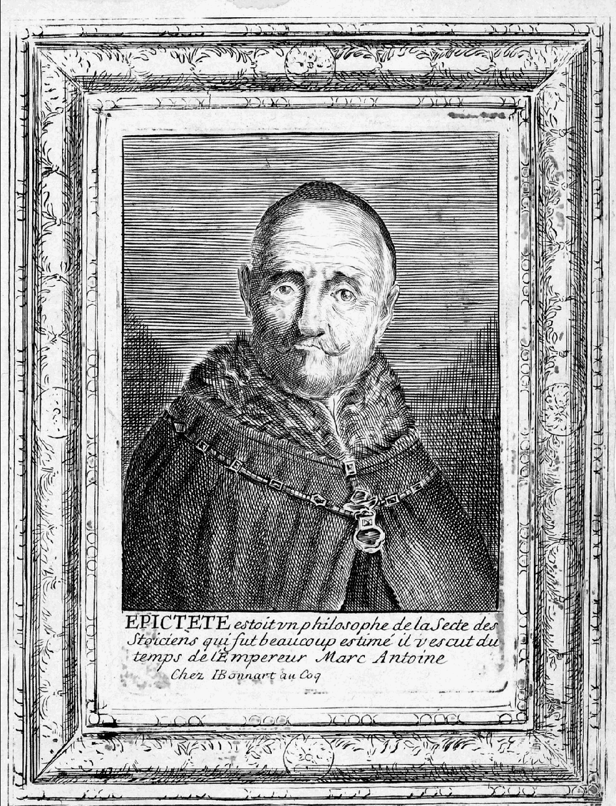{width="95%"}

::: credit
Епіктет, гравюра Анрі Боннара, бл. 1700
:::
:::

::: {.column width="56%"}
**Епіктет** народився рабом, кульгав, а згодом став одним з найшанованіших учителів Риму.

**Марк Аврелій** був римським імператором і вів щоденник, який ми тепер читаємо як «Роздуми».

::: {.show}
Одна й та сама філософія працювала для людини, в якої не було нічого, і для людини, в якої було все.
:::

::: {.bigquote}
Людей тривожать не речі, а їхні думки про речі.

[Епіктет]{.who}
:::
:::

::: {.column width="22%" .portrait}
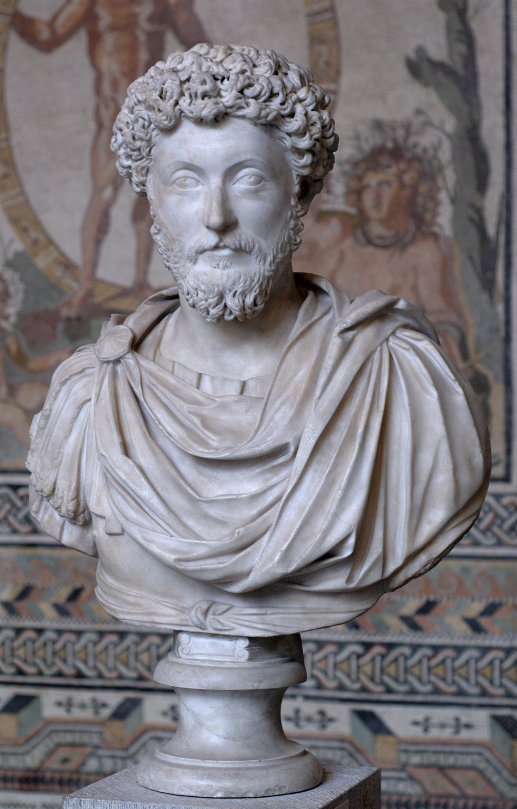{width="95%"}

::: credit
Марк Аврелій, Гліптотека, Мюнхен
:::
:::

::::

::: notes
Цитата: Епіктет, «Енхірідіон» (Посібник), 5.

Марк Аврелій писав «Роздуми» грецькою, для себе, переважно під час військових походів. Укр. переклади виходили під назвами «Наодинці з собою» та «Роздуми».
:::

## Дихотомія контролю {.b2}

:::: {.columns}

::: {.column width="55%"}
::: {.circles}
::: {.outer}
**Не залежить від мене**

результати рішень, реакції інших людей, економіка, погода, минуле, майбутнє

[*тут народжується тривога*]{.bottom}
:::

::: {.inner}
**Залежить від мене**

мої судження, наміри, реакції, цінності, зусилля
:::
:::
:::

::: {.column width="45%"}
::: {.bigquote}
Одне залежить від нас, інше ні.

[Епіктет]{.who}
:::

::: {.show}
Стоїки не кажуть «байдуже, що відбувається». Вони кажуть: **вкладайте сили у внутрішнє коло**, а на зовнішнє дивіться спокійно.
:::

::: {.pt-3}
Марк Аврелій: якщо тебе засмучує щось зовнішнє, то турбує тебе не воно, а твоє судження про нього. А судження в твоїй владі.
:::
:::

::::

::: notes
**Стоїцизм — дихотомія контролю (Епіктет, Марк Аврелій)**

Чіткий розподіл світу на дві корзини:

- **Підконтрольне мені:** мої судження, наміри, реакції, цінності, зусилля.
- **Непідконтрольне мені:** результати рішень, реакції інших людей, економіка, погода, минуле й майбутнє.

---

Цитати: «Енхірідіон», 1 (перше речення книги); Марк Аврелій, «Роздуми», VIII, 47.

Практичний висновок: перестати витрачати енергію на зовнішнє коло. Тривога виникає саме там.
:::

## Кейс: рейс скасовано {.b2}

::: {.case}
[Ситуація]{.label}

Завтра зранку важлива зустріч в іншому місті. О 22:00 приходить SMS: ваш рейс скасовано.
:::

:::: {.columns .pt-3}

::: {.column width="50%"}
::: {.answer .bad}
**Поза контролем:** скасування, погода, черга на стійці, настрій партнерів.
:::
:::

::: {.column width="50%"}
::: {.answer}
**У контролі:** шукати інший рейс чи потяг, написати партнерам зараз, запропонувати онлайн-формат, лягти спати замість гортання новин.
:::
:::

::::

::: {.pt-3}
Злість на авіакомпанію рейсу не поверне. Лист партнерам о 22:05 може врятувати зустріч.
:::

::: notes
Можна запитати зал, що перше спадає на думку. Зазвичай перші відповіді стосуються зовнішнього кола: «а чому», «хто винен». Стоїцизм переводить увагу на те, що можна зробити зараз.
:::

## Епікур: насолода без бенкету {.b2}

:::: {.columns}

::: {.column width="62%"}
Слово «епікуреєць» сьогодні означає гурмана. Сам Епікур жив на хлібі й воді і писав другові:

::: {.bigquote}
Пришли мені горщик сиру, щоб я міг розкошувати, коли захочу.
:::

::: {.show}
Мета Епікура не задоволення будь-якою ціною, а два стани спокою:

- **атараксія**: незворушність душі,
- **апонія**: відсутність болю в тілі.
:::
:::

::: {.column width="38%" .portrait}
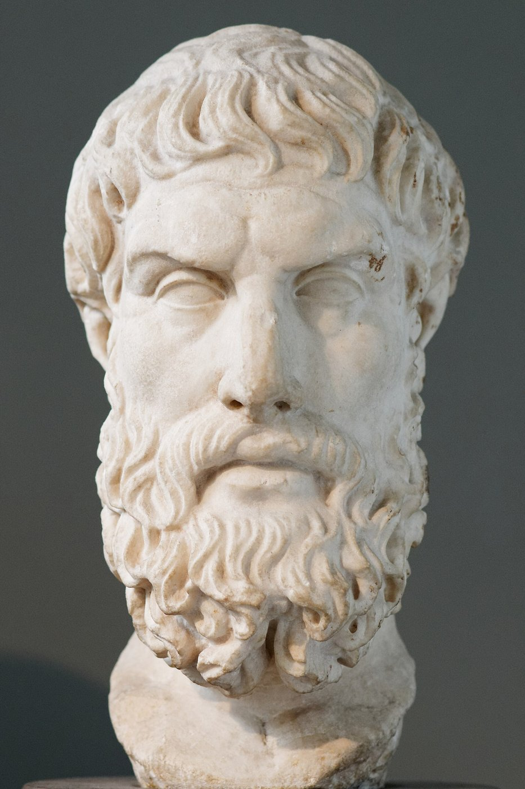{width="72%" fig-align="center"}

::: credit
Бюст Епікура, Британський музей
:::
:::

::::

::: notes
**Суть у трьох тезах**

1. **Мета життя не екстаз, а відсутність болю.** Справжнє щастя складається з двох речей: апонії (відсутності фізичного болю) та атараксії (незворушного спокою душі, вільного від страхів і тривоги).
2. **Калькулятор наслідків (гедоністичний розрахунок).** Епікур радив оцінювати кожне бажання запитанням: «Що буде після?». Якщо коротке задоволення сьогодні (зайвий келих, імпульсивна покупка, токсична суперечка) принесе більше головного болю чи тривоги завтра, від нього варто відмовитися.
3. **Головні вороги щастя не бідність, а марні страхи.** Епікур виділяв два головні джерела неврозів: страх перед покаранням вищих сил і страх смерті («Поки ми є, смерті немає; коли смерть приходить, нас уже немає»).

**Головний соціальний лайфхак Епікура**

- **Культ дружби замість гонитви за статусом.** Епікур купив будинок із садом під Афінами («Сад Епікура»), де жили й спілкувалися його друзі та учні. Він вважав, що з усіх речей, які мудрість дає для щасливого життя, найбільша — дружба: саме безпечне коло близьких людей дає відчуття захищеності в нестабільному світі.
- **Принцип «Живи непомітно» (Lathe biosas).** Не лізти в токсичну боротьбу за владу чи публічне схвалення, якщо це руйнує твій внутрішній мир.

**Практичний висновок**

У сучасному світі епікуреїзм — це усвідомлений мінімалізм та інформаційна дієта. Коли хочеться купити чергову річ «для статусу» або вв'язатися в суперечку в соцмережах, варто запитати себе: «Це додасть мені атараксії (спокою) чи лише накрутить тривожність?»

---

**Епікуреїзм — усвідомлене споживання та атараксія**

Справжня насолода не гедоністичний бенкет, а стан спокою душі (атараксія) та відсутність болю в тілі.

---

Анекдот про сир: Діоген Лаертський, «Життя знаменитих філософів», X, 11.

«Лист до Менекея», 131: коли ми кажемо, що насолода є метою, то маємо на увазі не насолоди розпусників, а відсутність страждань тілу й тривог душі.
:::

## Фільтр бажань {.b2}

:::: {.columns}

::: {.column width="58%"}
::: {.tiers}
::: {.tier .t1}
**Природні й необхідні**

їжа, тепло, сон, безпека, дружба
:::

::: {.tier .t2}
**Природні, але не необхідні**

вишукана їжа, гарні речі, комфорт понад потребу
:::

::: {.tier .t3}
**Ні природні, ні необхідні**

статус, слава, «щоб як у всіх», нескінченний скролінг
:::
:::
:::

::: {.column width="42%"}
::: {.show}
Перші легко задовольнити, і без них ми страждаємо.

Другі приємні, але без них можна жити.

Треті не мають межі: скільки б не отримав, хочеться ще.
:::

::: {.card .b2 .pt-3}
[Запитання перед покупкою]{.t}

До якого ярусу належить це бажання? І що станеться, якщо я його не виконаю?
:::
:::

::::

::: notes
**Фільтрація бажань:** розрізняйте природні й необхідні потреби (здорова їжа, базова безпека, тепла дружба) та нав'язані марнославні бажання (статусні атрибути, постійний дофаміновий скролінг).

---

Класифікація з «Лист до Менекея», 127, і «Головні думки», XXIX.

Усвідомлене споживання: щастя не в накопиченні, а в розрізненні. Дофаміновий скролінг тут чудовий приклад бажання третього ярусу: воно не має точки насичення.
:::

## Лао-цзи і принцип У-вей {.b2}

:::: {.columns}

::: {.column width="30%"}
::: {.glyph}
無為
:::

[*у-вей*: дія через недіяння]{.muted}

::: {.portrait}
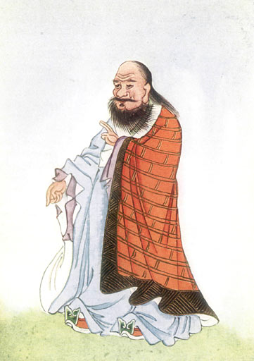{height="200px"}
:::

::: credit
Лао-цзи, китайська ілюстрація
:::
:::

::: {.column width="70%"}
У-вей не означає лінощі чи прокрастинацію. Це вміння **не боротися з природним плином речей**.

::: {.bigquote}
Немає у світі нічого м'якшого й слабшого за воду. Але ніщо не перевершить її, коли треба подолати тверде.

[Дао де цзін, 78]{.who}
:::

::: {.card .b2}
[Кухар Дін]{.t}

У Чжуан-цзи кухар дев'ятнадцять років розбирає туші одним ножем, і лезо досі гостре. Він не рубає кістку, а веде ніж уздовж природних суглобів.
:::
:::

::::

::: notes
**Приклади У-вей**

- **Робота й переговори.** Ви намагаєтеся переконати втомленого або роздратованого партнера ухвалити складне рішення тут і зараз. Чим більше тиснете, тим сильніший опір. У-вей — зробити паузу, дати емоціям охолонути й повернутися до розмови тоді, коли людина сама відкрита до діалогу.
- **Свідомість і сон.** Чим сильніше ви змушуєте себе заснути, контролюючи кожну хвилину, тим бадьорішим стає мозок. Сон приходить лише тоді, коли ви відпускаєте контроль над процесом.
- **Притча Чжуан-цзи про м'ясника Діна.** Майстерний м'ясник 19 років користувався одним ножем, і лезо залишалося гострим як бритва. Секрет у тому, що він ніколи не рубав кістки напролом: він відчував проміжки між суглобами і проводив лезо там, де немає опору.

**Практичний висновок для слухачів**

У-вей — це фільтр від вигоряння. Коли відчуваєте, що буксуєте і витрачаєте 90% сил на 10% результату, зупиніться і запитайте: «Я зараз рухаюся разом із потоком чи намагаюся рубати кістку тупим ножем? Що станеться, якщо я на добу відпущу контроль і поспостерігаю?»

---

Мистецтво таймінгу: не пробивати стіну лобом, коли двері зачинені, а чекати доречного моменту й діяти без саморуйнівного надзусилля. Збереження енергії від вигоряння.

Історія про кухаря Діна: «Чжуан-цзи», розділ 3 («Головне в плеканні життя»).
:::

## Три школи поруч {.b2}

| | Стоїцизм | Епікуреїзм | Даосизм |
|---|---|---|---|
| **Звідки стрес** | Хочемо контролювати те, що нам не підвладне | Женемося за бажаннями без межі | Боремося з плином подій |
| **Відповідь** | Розділити внутрішнє і зовнішнє | Розрізнити справжні й нав'язані потреби | Діяти вчасно і без надзусилля |
| **Вправа на тиждень** | Увечері розкласти день на два кола | Перед покупкою визначити ярус бажання | Помітити одну «стіну», яку б'єте лобом |

: {.striped}

::: notes
Підсумок блоку. Можна запитати: яка з трьох вправ вам найближча?
:::

# Сенс і вибір {.divider .at-3 background-color="#62005F"}

[Блок 3]{.kicker}

[Як брати відповідальність за свій вибір і знаходити сенс у рутині та кризі]{.lead}



## Жан-Поль Сартр: погана віра {.b3}

:::: {.columns}

::: {.column width="62%"}
::: {.bigquote}
Людина приречена бути вільною.

[Жан-Поль Сартр]{.who}
:::

Ми не обирали, чи бути вільними. Але відтоді кожна дія є вибором, навіть відмова вибирати.

::: {.show}
**Погана віра** (*mauvaise foi*) означає вдавати перед собою, що вибору не було.
:::

::: {.card .b3 .pt-3}
[Офіціант Сартра]{.t}

Він рухається надто старанно, кланяється надто точно, грає «офіціанта» так, ніби інакше не може. Хоча він людина, яка щоранку обирає цю роль.
:::
:::

::: {.column width="38%" .portrait}
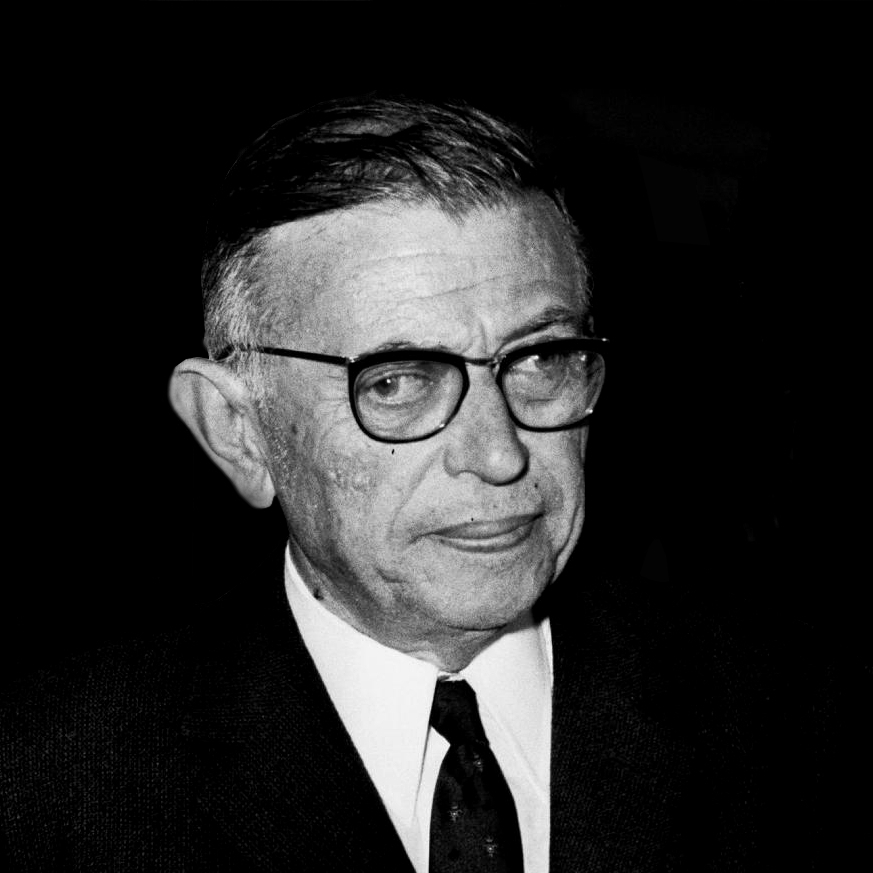{width="80%" fig-align="center"}

::: credit
Жан-Поль Сартр, 1967. Wikimedia Commons
:::
:::

::::

::: notes
**«Погана віра»** (фр. *mauvaise foi*) — концепція Жан-Поля Сартра, яка описує екзистенційний самообман: людина добровільно заперечує власну свободу, вдаючи, що не має вибору, щоб утекти від тривоги та відповідальності.

**Суть у трьох тезах**

1. **Фундамент: радикальна свобода.** За Сартром, «існування передує сутності»: людина не народжується із заданою програмою. Навіть відмова обирати чи бездіяльність теж є вибором.
2. **Механізм самообману.** Усвідомлення повної відповідальності за своє життя викликає екзистенційний жах (тривогу). Щоб заспокоїтися, людина «прикидається» річчю або заручником обставин, вигадуючи собі жорсткі рамки: «У мене не було вибору», «Так склалося», «Я просто такий за характером».
3. **Головна відмінність від звичайної брехні.** У звичайній брехні брехун знає правду, а жертва ні. У «поганій вірі» брехун і жертва — одна й та сама людина: свідомість сама від себе приховує правду про власну свободу.

**Два класичні приклади Сартра**

- **Офіціант у паризькому кафе.** Він рухається занадто точно, механічно й театрально, ніби грає роль офіціанта, а не просто працює. Він переконує себе, що «бути офіціантом» — його незмінна природа, як у чорнильниці чи стола, і знімає з себе тягар свободи бути кимось іншим.
- **Дівчина на побаченні.** Кавалер бере її за руку, натякаючи на близькість. Вона не хоче ні відштовхувати його (щоб не зіпсувати вечір), ні відповідати взаємністю. Тому залишає руку лежати в його долоні, вдаючи, що рука — просто неживий предмет, до якого її свідомість не має стосунку.

**Як це виглядає в сучасному житті (типові маркери)**

- **Злиття із соціальною роллю:** «Я не можу поводитися інакше, бо я керівник / мама / інтроверт / айтівець».
- **Фаталізм і виправдання минулим:** «Мене так виховали, я вже не змінюся», «У нашій країні / компанії інакше неможливо».
- **Перекладання суб'єктності на емоції:** «Я не хотів кричати, це просто нерви здали» (емоція подається як зовнішня стихія, якою людина нібито не керує).

**Практичний висновок для слухачів**

Подолати «погану віру» означає замінити «Я змушений / я не можу» на чесне «Я обираю це робити, бо мені так вигідніше або безпечніше». Саме в цій точці повертається контроль над власним життям.

---

Цитата: «Екзистенціалізм — це гуманізм» (1946). Приклад з офіціантом: «Буття і ніщо» (1943).

Зняття ілюзії «не було вибору» повертає людині відповідальність і разом з нею свободу творити своє життя.
:::

## Як звучить погана віра {.b3}

::: {.swap}
::: {.from}
«У мене не було вибору»
:::
::: {.arrow}
→
:::
::: {.to}
«Я обрав це, бо інший варіант здавався дорожчим»
:::

::: {.from}
«Такий вже я є»
:::
::: {.arrow}
→
:::
::: {.to}
«Досі я поводився так. Можу спробувати інакше»
:::

::: {.from}
«Винні обставини»
:::
::: {.arrow}
→
:::
::: {.to}
«Обставини звузили вибір. З того, що лишилось, обирав я»
:::

::: {.from}
«Так усі роблять»
:::
::: {.arrow}
→
:::
::: {.to}
«Я вирішив зробити так само, як усі»
:::
:::

::: {.pt-3}
Друга колонка звучить неприємніше. Зате в ній є **ви**, і ви можете щось змінити.
:::

::: notes
- Людина засуджена до свободи.
- **«Погана віра»** — це самообман, коли ми ховаємося за фразами: «Я не мав вибору», «Такий вже я є», «Винні обставини».
- Зняття ілюзії повертає людині повну відповідальність і свободу творити власне життя.

---

Можна запропонувати залу подумки перекласти одну свою фразу з лівої колонки в праву.
:::

## Кейс: «Не було вибору» {.b3}

::: {.case}
[Ситуація]{.label}

Подруга розповідає: «Я ненавиджу свою роботу третій рік. Але в мене не було вибору, я мусила залишитись».
:::

::: {.answer}
**Що сказав би Сартр:** вибір був. Можливо, всі інші варіанти були страшнішими: менша зарплата, невідомість, розмова з батьками. Але залишитись було рішенням.
:::

::: {.answer}
**Чому це важливо:** поки «не було вибору», немає й виходу. Щойно це стає рішенням, його можна переглянути.
:::

::: {.answer .bad}
**Чого Сартр не каже:** «звільнись завтра». Він каже: визнай, що вирішуєш ти, і вирішуй свідомо.
:::

::: notes
Важливо не перетворити Сартра на тренера з мотивації. Визнання вибору не означає, що вибір легкий чи що всі варіанти однаково доступні.
:::

## Альбер Камю: Сізиф {.b3 .over-image background-image="img/philosophy/sisyphus_titian.jpg" background-size="contain" background-position="right" background-color="#1a0d10"}

:::: {.columns}

::: {.column width="58%"}
::: {.panel}
Боги покарали Сізифа: вічно котити камінь на гору, звідки той щоразу скочується.

Камю бачить у ньому кожного з нас: дедлайни, побут, рутина.

::: {.show}
**Абсурд**: ми шукаємо сенс, а світ мовчить. Відповідь Камю не втеча і не відчай, а **бунт**: жити свідомо й з гідністю.
:::

::: {.bigquote}
Треба уявляти Сізифа щасливим.

[Альбер Камю, «Міф про Сізифа»]{.who}
:::

::: credit
Тиціан, «Сізиф», 1548–1549, Прадо
:::
:::
:::

::::

::: notes
**Головна думка:** сенс народжується не в нагороді на вершині гори, а в бунті свідомості: приймати свій шлях із гідністю та усмішкою.

---

«Міф про Сізифа», 1942; цитата завершує есей. Сенс народжується не в нагороді на вершині, а в ставленні до самого шляху. Сізиф щасливий не тому, що камінь став легшим, а тому, що він знає свою долю й не тікає від неї.

Камю отримав Нобелівську премію з літератури 1957 року.
:::

## Віктор Франкл: воля до сенсу {.b3}

:::: {.columns}

::: {.column width="35%" .portrait}
{width="85%" fig-align="center"}

::: credit
Віктор Франкл. Prof. Dr. Franz Vesely, Wikimedia Commons
:::
:::

::: {.column width="65%"}
Віденський психіатр. Пройшов чотири концтабори, зокрема Аушвіц. Втратив батьків, дружину й брата.

Після звільнення за дев'ять днів написав книжку «Людина в пошуках справжнього сенсу».

::: {.bigquote}
Хто має **навіщо** жити, витримає майже будь-яке **як**.

[Франкл цитує Ніцше]{.who}
:::

::: {.show}
Головною рушійною силою людини Франкл вважав не насолоду і не владу, а **пошук сенсу**. На цьому побудована його логотерапія.
:::
:::

::::

::: notes
Ще одна цитата з тієї ж книжки: у людини можна забрати все, крім останньої зі свобод: обирати своє ставлення за будь-яких обставин.

Ніцше, «Присмерки ідолів», «Афоризми і стріли», 12.
:::

## Де шукати сенс за Франклом {.b3}

::: {.cards .c3}
::: {.card .b3}
[Творення]{.t}

Робота, творчість, допомога іншим.

Те, що ви **даєте** світу.
:::

::: {.card .b3}
[Переживання]{.t}

Любов, краса природи, мистецтво, зустріч з людиною.

Те, що ви **берете** від світу.
:::

::: {.card .b3}
[Ставлення]{.t}

Гідність і мужність перед неминучим стражданням.

Те, як ви **стоїте** перед тим, чого не змінити.
:::
:::

::: {.pt-3 .big}
Третій шлях відкритий навіть тоді, коли перші два закриті.
:::

::: notes
**Логотерапія та опора у важкі часи**

Пошук сенсу як головна рушійна сила людини.

Три вектори знаходження сенсу за Франклом:

- **У творенні:** робота, творчість, допомога іншим.
- **У переживанні досвіду:** любов, краса природи, мистецтво.
- **У позиції щодо неминучих страждань:** гідність і мужність зустрічати виклики долі.

---

Тут можна зв'язати з попереднім блоком: третій шлях Франкла схожий на дихотомію контролю. Подія поза нами, ставлення до неї в нас.
:::

# Люди навколо {.divider .at-4 background-color="#FB4F01"}

[Блок 4]{.kicker}

[Як бачити в людях людей, приймати важкі моральні рішення і розуміти, що тримає дружбу]{.lead}



## Мартін Бубер: Я–Ти і Я–Воно {.b4}

:::: {.columns}

::: {.column width="65%"}
::: {.cards .c2}
::: {.card .b4}
[Я–Воно]{.t}

Інша людина як **функція**: ресурс, засіб, перешкода.

Кур'єр, «той, хто має закрити задачу», «проблема в команді».
:::

::: {.card .b4}
[Я–Ти]{.t}

Зустріч двох **суб'єктів** без розрахунку і маніпуляцій.

Ви бачите людину цілком, а не лише її роль.
:::
:::

::: {.pt-3}
Бубер не вимагає жити тільки в Я–Ти: без Я–Воно не працює жоден офіс. Небезпечно, коли інших стосунків, крім Я–Воно, не лишається.
:::

::: {.bigquote}
Усяке справжнє життя є зустріччю.

[Мартін Бубер, «Я і Ти»]{.who}
:::
:::

::: {.column width="35%" .portrait}
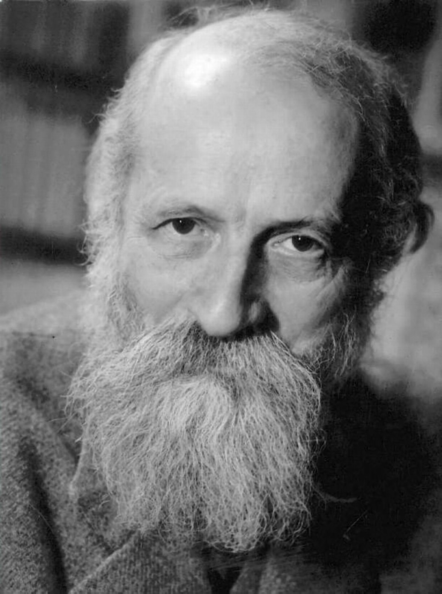{width="80%" fig-align="center"}

::: credit
Мартін Бубер. Wikimedia Commons
:::
:::

::::

::: notes
- **«Я–Воно»:** ми сприймаємо іншу людину функціонально: як ресурс, засіб для досягнення цілі чи проблему на шляху.
- **«Я–Ти»:** відкрита, щира зустріч двох суб'єктів без маніпуляцій і споживацького розрахунку.

---

«Я і Ти» (Ich und Du), 1923. Бубер народився у Відні, дитинство провів у Львові в діда, відомого дослідника Мідраша Соломона Бубера.

Приклад: та сама розмова з колегою може бути «скільки ще ти будеш возитися з задачею» (Я–Воно) або «бачу, задача застрягла, що заважає?» (Я–Ти).
:::

## Кант чи утилітаристи? {.b4}

:::: {.columns}

::: {.column width="50%"}
::: {.card .b4}
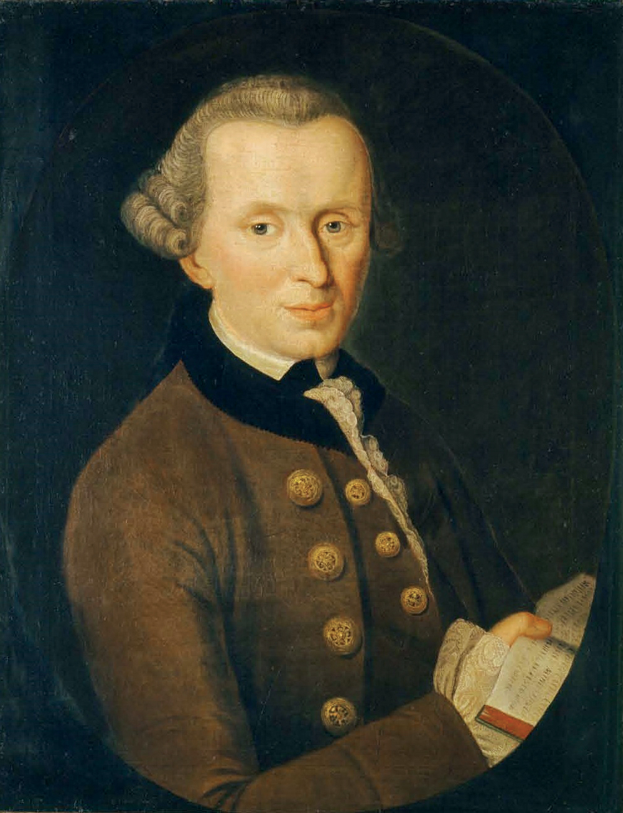{height="190px"}

[Іммануїл Кант]{.t}

Мораль визначає **правило**, а не наслідок.

Чини так, щоб правило твоєї дії могло стати загальним законом.

Людина завжди **мета** і ніколи лише **засіб**.
:::
:::

::: {.column width="50%"}
::: {.card .b4}
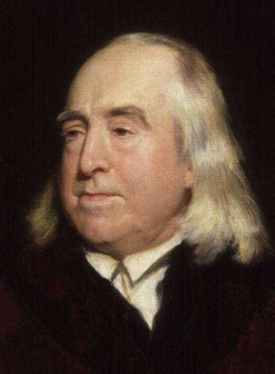{height="190px"} 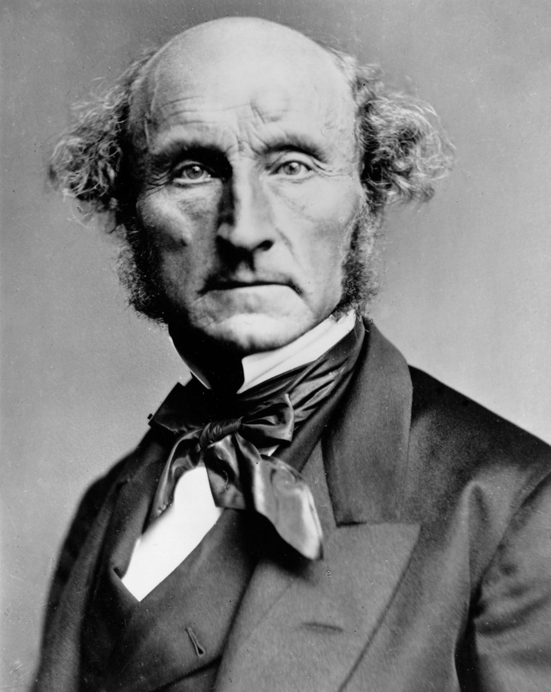{height="190px"}

[Бентам і Мілль]{.t}

Мораль визначають **наслідки**.

Правильна та дія, що дає найбільше щастя найбільшій кількості людей.

Рахуємо всіх, і кожен важить однаково.
:::
:::

::::

::: {.pt-3 .big}
Де межа між благом більшості та захистом меншості?
:::

::: credit
Портрети: Й. Г. Бекер (Кант), Г. В. Пікерсгіл (Бентам), London Stereoscopic Company (Мілль)
:::

::: notes
- **Деонтологія Іммануїла Канта (категоричний імператив):** людина завжди є кінцевою метою і ніколи лише засобом. Вчиняй за тими правилами, які хотів би бачити загальним моральним законом.
- **Утилітаризм (Бентам, Мілль):** принцип найбільшої користі та щастя для максимальної кількості людей.
- **Запитання до залу:** де проходить межа між благом більшості та захистом меншості?

---

Деонтологія Канта: категоричний імператив з «Основ метафізики моралі» (1785). Друге формулювання про людину як мету.

Бентам: «найбільше щастя найбільшої кількості людей» («Фрагмент про державне управління», 1776). Мілль розвинув утилітаризм і додав різницю між «вищими» і «нижчими» насолодами.
:::

## Кейс: вагонетка {.b4}

:::: {.columns}

::: {.column width="55%"}
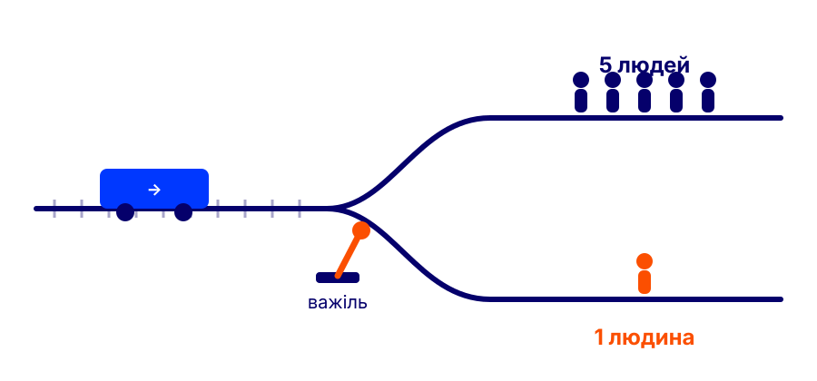{width="100%"}

[Філіппа Фут, 1967]{.muted .aside-note}
:::

::: {.column width="45%"}
::: {.case}
[Ситуація]{.label}

Вагонетка без гальм мчить на п'ятьох. Ви біля важеля: можна перевести її на колію, де одна людина.
:::

::: {.answer}
**Утилітарист:** тягнути. П'ять життів більше за одне.
:::

::: {.answer}
**Кантіанець:** ви робите людину засобом для порятунку інших. Чи маєте право?
:::
:::

::::

::: {.card .b4 .pt-3}
[Чи є третій варіант?]{.t}
:::

::: notes
**«Дилема вагонетки»** (англ. *trolley problem*) — класичний уявний експеримент для протиставлення утилітаризму й деонтології Канта. Вперше її сформулювала Філіппа Фут (1967), а Джудіт Джарвіс Томсон (1976, 1985) розширила її варіантом із товстуном на мосту, щоб показати, де саме ламається чиста математика користі.

**1. Класична версія (Філіппа Фут)**

Некерована вагонетка мчить рейками, до яких прив'язані 5 людей. Ви стоїте біля стрілки і можете перевести вагонетку на запасну колію, де прив'язана 1 людина.

- **Результат опитувань:** ~90% людей натискають важіль (рятують п'ятьох ціною одного).
- **Логіка утилітаризму (Бентам, Мілль):** 5 > 1. Найбільше благо для найбільшої кількості людей — правильний математичний розрахунок.

**2. Варіант Джудіт Томсон: товстун на мосту**

Вагонетка так само мчить на 5 людей. Ви стоїте на пішохідному мосту над коліями. Поруч стоїть дуже масивний чоловік. Єдиний спосіб зупинити вагонетку — штовхнути його з мосту на рейки. Він загине, але його маса зупинить вагонетку, і п'ятеро виживуть.

- **Результат опитувань:** ~90% людей відмовляються штовхати чоловіка, хоча математика та сама (5 життів проти 1).

**Чому виникає цей моральний парадокс?**

Томсон використала цей контраст, щоб зіштовхнути дві великі етичні системи: утилітаризм і деонтологію Іммануїла Канта.

**Головний інсайт Томсон (доктрина подвійного ефекту та межі прав):** на мосту ви порушуєте фундаментальне право людини на недоторканність, активно використовуєте її як ресурс, інструмент для порятунку інших. Інтуїція кричить «ні!», бо всередині нас сидить кантіанець: не можна перетворювати людину на річ навіть заради шляхетної статистики.

**Як провести на лекції**

1. **Швидке голосування залу (30 с):** який варіант оберете? Аудиторія майже гарантовано дасть класичний розрив: натиснуть стрілку, але не штовхнуть із мосту.
2. **Розбір механіки (1,5 хв):** у першому випадку працює утилітаризм (рахуємо наслідки: 5 > 1), а в другому вмикається деонтологія Канта та принцип Бубера («Я–Ти» проти «Я–Воно»): на мосту ми перетворюємо живу людину на «Воно», на звичайне гальмо для вагонетки.
3. **Приземлення в реальне життя (1 хв):**
   - **Бізнес і менеджмент:** звільнити одного лояльного працівника, щоб урізати бюджет і врятувати відділ. Чи чесно це, і чи не ставимося ми до людей виключно як до «людського ресурсу»?
   - **Сучасні технології:** алгоритми безпілотних авто. Кого має рятувати автопілот під час неминучої аварії: пасажира всередині чи групу пішоходів на переході?
:::

## Арістотель: три види дружби {.b4}

:::: {.columns}

::: {.column width="70%"}
::: {.cards .c3}
::: {.card .b4}
[Заради користі]{.t}

Діловий нетворкінг, партнери, сусіди по проєкту.

**Зникає користь, зникає зв'язок.**
:::

::: {.card .b4}
[Заради задоволення]{.t}

Компанія на вихідні, спільне хобі.

**Змінюються інтереси, друзі розходяться.**
:::

::: {.card .b4}
[Заради чесноти]{.t}

Рівні люди, які поважають одне одного і хочуть один одному добра.

**Найрідкісніша і найміцніша.**
:::
:::

::: {.pt-3}
Перші дві не погані. Вони просто тримаються на чомусь зовнішньому, а третя тримається на самих людях.
:::
:::

::: {.column width="30%" .portrait}
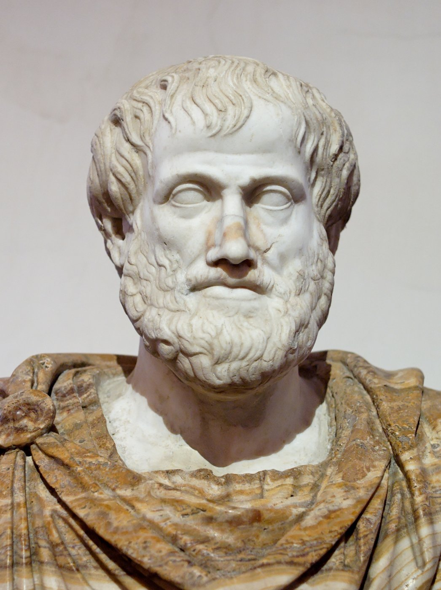{width="85%" fig-align="center"}

::: credit
Арістотель, мармурова копія за Лісиппом
:::
:::

::::

::: notes
**Арістотель — три типи дружби**

- **Задля вигоди:** діловий нетворкінг.
- **Задля задоволення:** весела компанія на вихідні.
- **Істинна дружба чесноти:** взаємне прагнення до спільного блага й розвитку.

---

«Нікомахова етика», книги VIII–IX. Арістотель додає, що дружба чесноти потребує часу: «не можна пізнати одне одного, доки не з'їси разом багато солі».

Діоген Лаертський приписує Арістотелю вислів: друг — це одна душа, що живе у двох тілах.

Можна запитати зал: подумайте про трьох близьких людей. Що тримає кожен з цих зв'язків?
:::

# Що забрати з собою {.divider background-color="#0038FF" background-image="img/philosophy/school_athens.jpg" background-opacity="0.18" background-size="cover"}

[Рафаель, «Афінська школа», 1509–1511]{.credit style="color: rgba(255,255,255,.7) !important;"}

## Чотири правила на кожен день {.no-line}

::: {.rules}
::: {.rule .b1}
[Помітили тривожну думку?]{.if}

[Сократівський діалог: перевірте факти]{.then}
:::

::: {.rule .b1}
[Підозрюєте змову чи накручуєте образу?]{.if}

[Бритви Оккама і Генлона]{.then}
:::

::: {.rule .b2}
[Штормить від новин і хаосу?]{.if}

[Дихотомія контролю: два кола]{.then}
:::

::: {.rule .b4}
[Говорите з колегою чи партнером?]{.if}

[Перемкніться з Я–Воно на Я–Ти]{.then}
:::
:::

::: {.pt-3}
А коли здається, що вибору немає, згадайте Сартра. Коли все здається марним, згадайте Франкла.
:::

::: notes
Підсумок. Чотири «команди» з плану лекції. Останній рядок зв'язує блок 3, якого немає серед чотирьох карток.
:::

## Що почитати далі {#reading}

::: {.books}
::: {.book .b1}
[Платон]{.muted}

[Апологія Сократа]{.ttl}

Промова Сократа на суді. Коротко і дуже живо.
:::

::: {.book .b2}
[Марк Аврелій]{.muted}

[Наодинці з собою (Роздуми)]{.ttl}

Щоденник імператора, якого ніхто не мав читати.
:::

::: {.book .b3}
[Віктор Франкл]{.muted}

[Людина в пошуках справжнього сенсу]{.ttl}

Табір, логотерапія і питання «навіщо».
:::

::: {.book .b3}
[Альбер Камю]{.muted}

[Міф про Сізифа]{.ttl}

Есей про абсурд і про те, чому варто жити.
:::

::: {.book .b4}
[Мартін Бубер]{.muted}

[Я і Ти]{.ttl}

Невелика книжка про те, як ми зустрічаємо інших.
:::

::: {.book .b4}
[Арістотель]{.muted}

[Нікомахова етика]{.ttl}

Книги VIII–IX про дружбу.
:::
:::

::: notes
Усі шість книжок мають українські переклади.
:::

## Дякую! Ваші питання {.no-line background-iframe="libs/philosophy-bg/index.html" background-interactive="true"}

:::: {.columns .pt-5}

::: {.column width="50%" .qr}
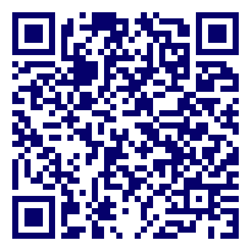

Ця презентація
:::

::: {.column width="50%" .qr}
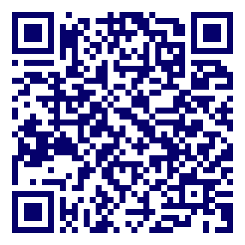

Що почитати далі
:::

::::
